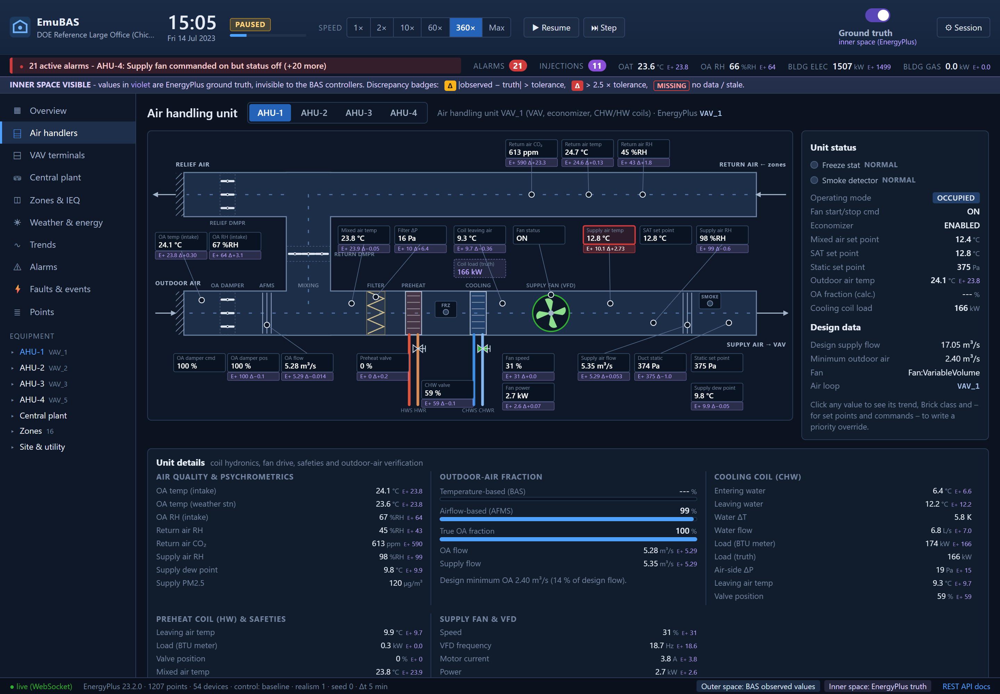
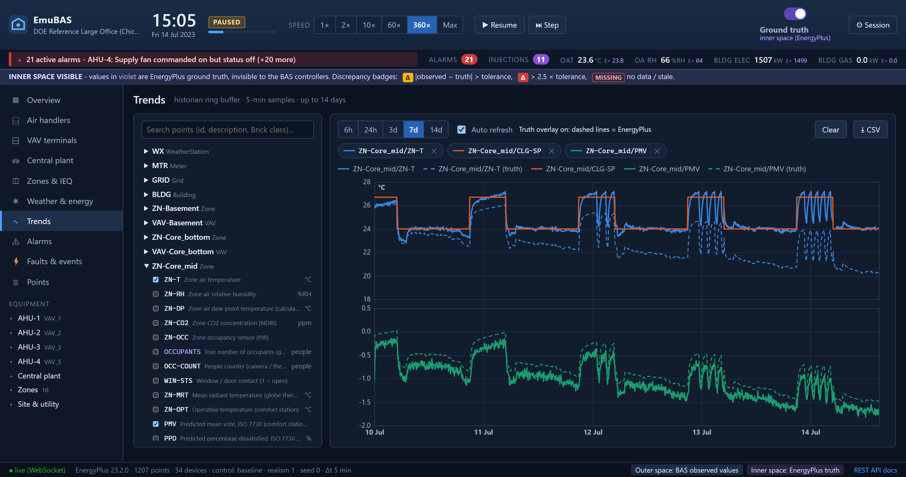
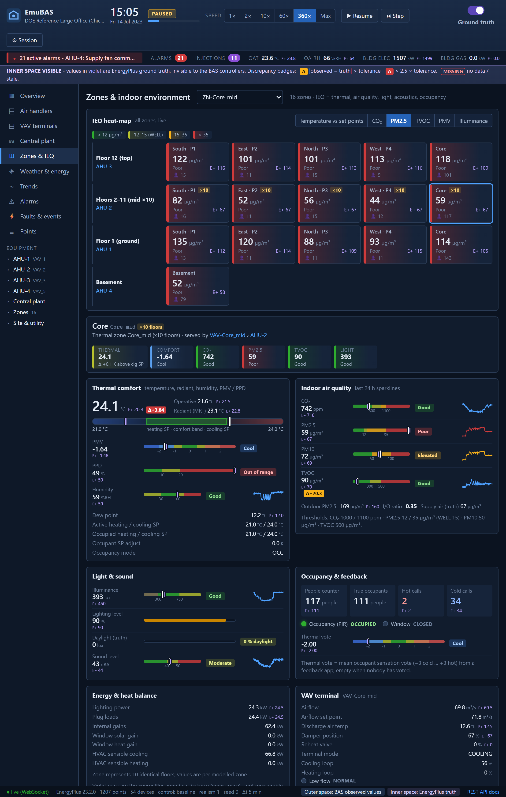
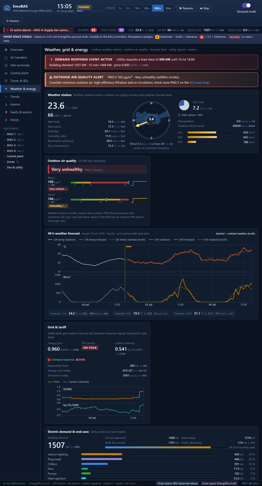
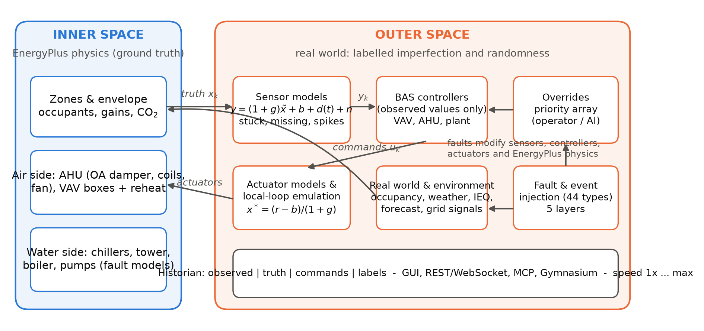
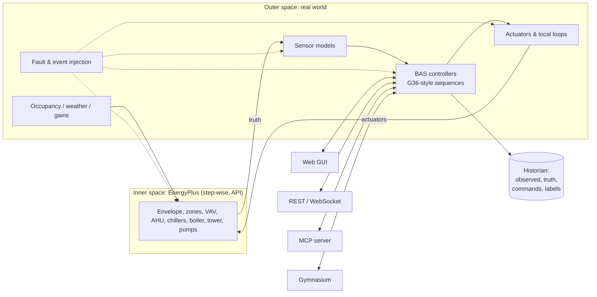

# EmuBAS

**An open-source emulator of real-world building automation systems (BAS), driven step by step by EnergyPlus - with
labelled sensor drift, noise, data loss, stochastic occupancy and equipment/control faults that people, scripts and AI
agents can inject at run time.**

> EmuBAS (emulated BAS) was called *Virtual BAS* until November 2026. The Python package (`virtualbas`), the command
> line (`vbas`) and this repository's URL keep their names, so existing installs and scripts work unchanged.

[](https://github.com/TensorBuildLab/Virtual-BAS/actions/workflows/ci.yml)
  



Real buildings are messy: sensors drift, controllers act on wrong readings, occupants behave randomly, equipment
degrades and data go missing. Everything meant to improve building operation - control sequences, fault detection,
analytics, model predictive and learning-based control, AI agents, and the people who run buildings - must work in
such conditions, but testing in real buildings is slow, risky and without ground truth.
EmuBAS provides that environment:

* **Inner space** - EnergyPlus is the physics. It is advanced one BAS sample (default 5 min) at a time through the
  EnergyPlus Python API and suspended while the BAS computes.
* **Outer space** - the real world on top: sensor models (bias, gain, drift, noise, lag, quantisation, spikes, stuck,
  bursty missing data), actuator models (stuck dampers/valves, failures), BAS controllers that only see *observed*
  values, stochastic occupancy, weather and internal-gain events, and a library of 44 faults/events on five layers
  (sensor, actuator, equipment, control, network). Every imperfection is defined by an equation and **labelled**.
* **Equipment level** - VAV boxes, AHUs (economizer, coils, fan, filter, static pressure, freeze-stat), chillers
  (incl. refrigerant side), boiler, cooling tower, pumps and DHW are all exposed as BAS points, with Haystack tags and
  Brick classes - 1,207 points for the large office.
* **Full environment** - every zone reports temperature, humidity, CO2, PM2.5/PM10, TVOC, illuminance, sound, mean
  radiant/operative temperature, PMV/PPD, people counts and occupant feedback; the weather station reports 20+ variables
  plus forecasts; utility meters, sub-meters, tariffs, grid carbon intensity and demand-response signals are included.
* **Today's BAS vs. next-generation BAS** - each point is tagged *standard* (typical BAS today), *advanced* or
  *next_gen* (rarely installed but valuable for AI), so the value of extra sensors can be quantified
  ([point taxonomy](docs/point_taxonomy.md)).
* **Time control** - real time (1x), 2x, 10x, 60x, 360x, ... or as fast as possible (one simulated year of the large
  office in ~5 minutes, about 90,000x real time), changeable while running; pause and single-step.
* **Injection by humans and AI** - GUI, scenario files, REST API, Python client, MCP server (LLM agents), Gymnasium
  environment, and a random fault generator.
* **Generic methodology** - any EnergyPlus model is converted automatically (`vbas prepare`): topology discovery,
  command binding, physical fault hooks, native control program, point list. Case study: DOE reference large office.

## Who is it for?

A real BAS is a poor place to learn or experiment: you cannot stage faults, you never know the true state, mistakes
affect occupants, and access is restricted. EmuBAS is **safe to break, labelled, repeatable, fast and open**, so it
serves far more than algorithm research:

| Area | Uses |
|---|---|
| **Building AI research** | FDD development and benchmarking · supervisory / MPC / RL control under realistic sensors and faults · ambient-AI and LLM operators (and AI adversaries) · synthetic BAS data for foundation models · virtual sensing and sensor recalibration · metadata inference (Brick/Haystack) · value of extra sensors |
| **Education and workforce** | university courses on HVAC, controls, building energy and building data science · troubleshooting drills for building operators, facility managers and technicians · commissioning practice · emergency drills (wildfire smoke, heat waves, equipment trips, demand response) · alarm-management and HMI research |
| **Industry practice** | neutral testing of commercial FDD and analytics products · control-sequence verification and virtual commissioning before site work · a mock building for BAS software CI, demos and sales · cyber-physical security studies · demand-response and carbon-aware control |
| **Research community** | shared benchmarks, competitions and exactly reproducible studies |

Aviation and nuclear power train their operators on simulators, and self-driving AI is developed in open simulators
before it reaches the road. EmuBAS aims to be that simulator for buildings, for both their people and their AI.
See [docs/use_cases.md](docs/use_cases.md) for all 18 uses, how far each is supported today, and recipes (teaching a
lab, running an operator drill with [`scenarios/training_drill.yaml`](scenarios/training_drill.yaml), testing an
analytics product, quantifying the value of a sensor).

## Quick start

```bash
# 1. EnergyPlus 23.2: https://github.com/NREL/EnergyPlus/releases/tag/v23.2.0
# 2. EmuBAS
git clone https://github.com/TensorBuildLab/Virtual-BAS.git && cd Virtual-BAS
python -m venv .venv && source .venv/bin/activate          # Windows: .venv\Scripts\activate
pip install -e ".[all]"
vbas doctor                                                 # finds EnergyPlus and its Python API

# 3. a live BAS (open http://127.0.0.1:8000)
vbas serve --building buildings/large_office --scenario scenarios/demo_summer.yaml --speed 60x

# 4. or a labelled dataset in one shot
vbas run --building buildings/large_office --scenario scenarios/fdd_dataset.yaml --out results/fdd
```

See [docs/installation.md](docs/installation.md) for details and troubleshooting.

## The idea in one example

A zone temperature sensor drifts by +0.5 K/day. The VAV controller does not know; it keeps the *observed* temperature
at 24 °C, commands more air flow to EnergyPlus, and the *true* zone gets colder every day. EmuBAS records both
trajectories, the commands, and the label "`sensor_drift` on `ZN-Core_mid/ZN-T`, rate 0.5 K/day, since t0".

```yaml
# scenarios/drift_example.yaml
start: 2023-07-10
end: 2023-07-16
realism: 1.0
occupancy: {stochastic: true}
injections:
  - {type: sensor_drift, target: ZN-Core_mid/ZN-T, start: 2023-07-11T00:00:00, params: {rate_per_day: 0.5}}
```



| Zones & indoor environment | Weather, forecast, grid & energy |
|---|---|
|  |  |

## Architecture



The same loop as a flow chart:



| Package | Content |
|---|---|
| `virtualbas/model` | epJSON I/O, topology discovery, BAS-ization (`prepare`) |
| `virtualbas/engine` | step-wise EnergyPlus runner (callbacks, actuators, weather perturbation) |
| `virtualbas/realworld` | sensor models, fault & event library, stochastic occupancy, random fault generator |
| `virtualbas/control` | PI / trim-and-respond, VAV, AHU and plant sequences (baseline & G36-inspired) |
| `virtualbas/bas` | point catalog (Haystack/Brick), historian, alarm engine |
| `virtualbas/core.py` | orchestrator: inner/outer coupling, local-loop emulation, priority overrides, pacing |
| `virtualbas/server` | FastAPI server and the web GUI (vanilla JS, offline) |
| `virtualbas/ai` | REST client, MCP server, Gymnasium environment |
| `experiments/` | all experiments of the paper (verification, fault matrix, FDD benchmark, speed, generality, AI agents) |

## Documentation

* [Use cases: research, teaching, operator training, industry](docs/use_cases.md)
* [Installation](docs/installation.md)
* [Concepts: inner/outer space, local-loop emulation, BAS-ization, labels](docs/concepts.md)
* [Point taxonomy: standard vs. advanced vs. next-generation BAS points, environment models, sensor accuracy](docs/point_taxonomy.md)
* [Tutorial 1 - run your first virtual BAS](docs/tutorial_1_run_your_first_virtual_bas.md)
* [Tutorial 2 - faults, events and scenarios](docs/tutorial_2_faults_events_scenarios.md)
* [Tutorial 3 - AI agents (REST, MCP, Gymnasium)](docs/tutorial_3_ai_agents.md)
* [Tutorial 4 - convert your own building](docs/tutorial_4_convert_your_building.md)
* [Output data format](docs/data_format.md) · [Fault & event catalog](docs/fault_catalog.md) · [Point list (large office)](docs/point_list_large_office.md)
* Examples: [`examples/`](examples) · Interactive API docs: `http://127.0.0.1:8000/docs`

## Verification (summary)

With ideal sensors and the baseline BAS program, a full year of the DOE large office driven by EmuBAS reproduces
the native EnergyPlus simulation within 0.5 % for electricity, 5 % for gas and 0.03 K mean absolute zone-temperature
difference (details in the paper and `experiments/exp1_validation.py`).

## Citing

If you use EmuBAS, please cite the software (see [CITATION.cff](CITATION.cff)) and the accompanying article
(*Energy and Buildings*, under review). The manuscript text is [`paper/manuscript.md`](paper/manuscript.md), built into
a Word manuscript (`paper/manuscript.docx`, PDF alongside) with the author's manuscript template; every figure is
generated from code. See [paper/submission/README.md](paper/submission/README.md) for the build steps,
[paper/revisions/](paper/revisions) for review rounds and [paper/archive/](paper/archive) for earlier versions.

## License

MIT - see [LICENSE](LICENSE). The DOE reference building model and weather file are redistributed from EnergyPlus,
see [NOTICE.md](NOTICE.md).
