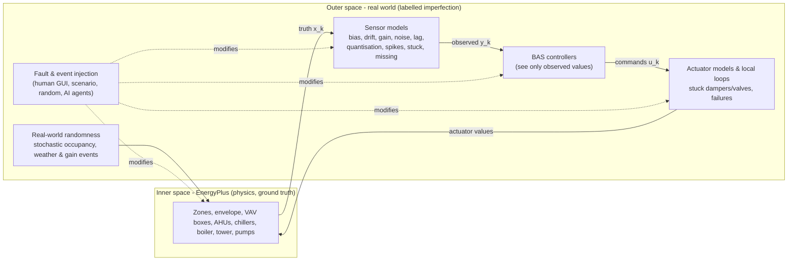

# Concepts: inner space, outer space and the BAS-ization of an EnergyPlus model

## Two spaces

* The **inner space** is the EnergyPlus simulation. It represents the real physics and is advanced **one zone time
  step at a time** (default 5 min) through the EnergyPlus Python API. EnergyPlus is suspended while the outer space
  computes, so the simulation is truly step-wise (co-simulation), not a batch run.
* The **outer space** is everything a real building adds on top of the physics: imperfect sensors, data loss,
  random occupants, equipment and control faults, operator overrides - and the BAS itself, which can only act on
  what its sensors report.

Example: a zone temperature sensor drifts by +0.5 K/day. The VAV controller does not know it; it controls the
*observed* temperature to 24 °C, so it sends larger air-flow commands to EnergyPlus and the *true* zone becomes
colder every day. Both the observed and the true trajectory, and the label "sensor_drift active on
ZN-Core_mid/ZN-T since t0 with rate 0.5 K/day", are recorded.

## One BAS sample

1. Read the EnergyPlus truth *x_k* (output variables, meters, derived quantities).
2. Apply the active injections and compute the observed values *y_k* with the sensor models. Missing samples are
   `NaN` in the trend log; the BAS keeps the last good value as present value (as real controllers do).
3. Run the BAS control sequences on the present values; apply operator/AI overrides (BACnet-like priority array).
4. Map commands to EnergyPlus actuators through the actuator models (stuck damper, failed fan, ...) and the
   *local-loop emulation* (below); apply physical faults (fouling, degradation, trips) and real-world events.
5. Record observed values, truth, commands and labels; pace the clock to the requested speed (1x ... max).

## Local-loop emulation by set-point translation

Some loops are closed *inside* EnergyPlus by ideal local controllers (reheat valve to zone heating set point, chilled
water valve to supply-air temperature, chiller to leaving water temperature). A real local loop drives its *measured*
value to the set point r. For a sensor with deterministic map y = (1+g)x + b, the true controlled value settles at

    x* = (r - b) / (1 + g)

so Virtual BAS hands x* (instead of r) to the ideal EnergyPlus controller. A stuck or spoofed reading makes the
integral action wind up; the actuator then saturates (x* = upper or lower limit). An unavailable reading makes the
controller hold its last output. This makes every sensor fault propagate physically, also through loops that
EnergyPlus solves internally.

## BAS-ization: converting any EnergyPlus model

`vbas prepare` (module `virtualbas.model.prepare`) applies generic, documented transformations:

| | Transformation |
|---|---|
| T1 | run the weather-file period only (sizing still performed) |
| T2 | zone time step = BAS sampling interval |
| T3 | run period / calendar year |
| T4 | remove file outputs (data are exchanged through the API) |
| T5 | **command binding**: every BAS write (SAT set points, plant supply temperatures, fan enable, VAV air-flow commands) is bound to a `Schedule:Constant` that is overwritten at run time; VAV boxes are hard-sized from a native sizing run first |
| T6 | **physical fault hooks**: EnergyPlus `FaultModel:Fouling:*` objects on chillers, boilers and towers |
| T7 | zone CO2 balance |

The HVAC topology (zones, terminals, AHUs, coils, fans, plant loops, chillers, boilers, towers, pumps) is discovered
from EnergyPlus' own connection objects, and the BAS point list is generated from it with Project-Haystack style
tags and Brick classes. The default BAS program reproduces the native schedules and set points of the source model,
so a run with ideal sensors reproduces the native EnergyPlus result (see the paper, Experiment 1).

Currently supported for explicit BAS control: multi-zone VAV systems with `AirTerminal:SingleDuct:VAV:Reheat` /
`:NoReheat` terminals, water coils, `Fan:VariableVolume`, `Controller:OutdoorAir`, water-cooled chillers, hot-water
boilers, cooling towers and pumps. Other systems (e.g. packaged single-zone units) are still monitored and keep their
native local control; their thermostats are BAS-controlled.

## Labels

* `injections_table.json` - every injection (id, type, layer, target, start, end, profile, parameters, source).
* `injections.parquet` - severity of every active injection at every sample.
* `labels.parquet` - per point and sample, a bit mask: 1 missing, 2 stuck, 4 spike, 8 sensor fault active,
  16 communication loss, 32 false binary reading, 64 spoofed/overridden value.
* `truth.parquet` vs `observed.parquet` - the exact sensor error of every sample.
* `sensors.json` - installation bias, gain and drift rate drawn for every sensor.
