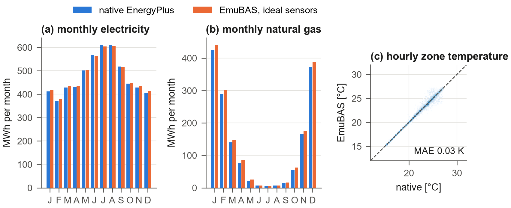
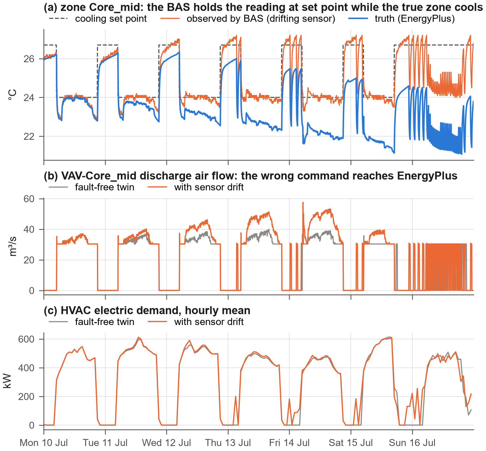
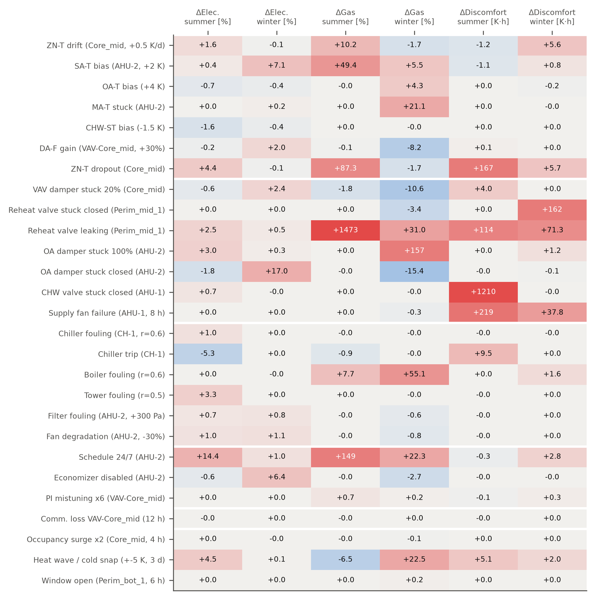
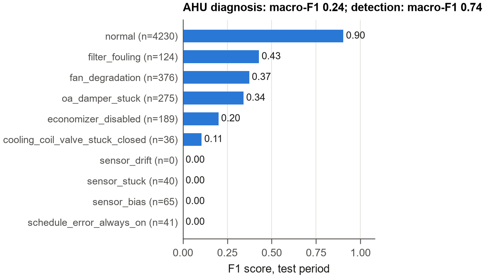
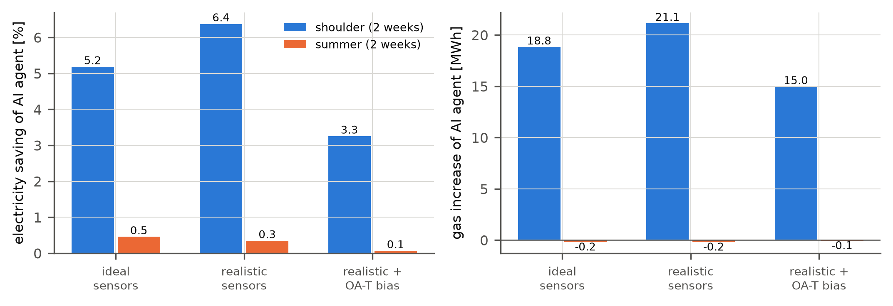
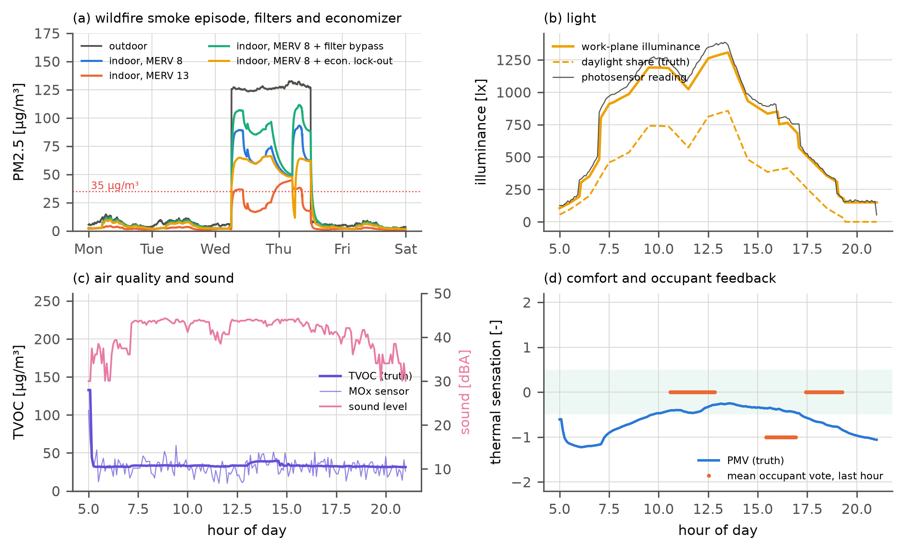
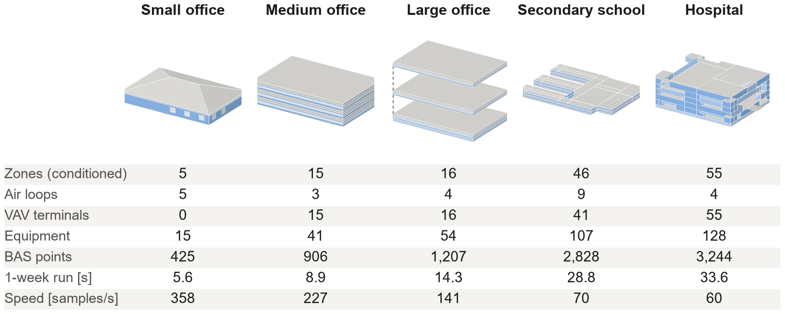
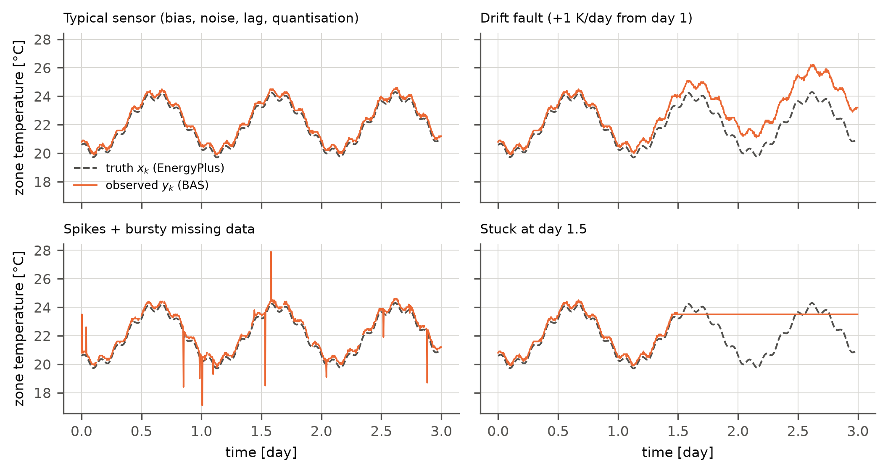
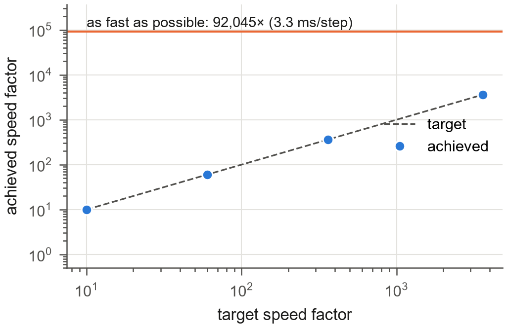

<!-- Master text of the manuscript. Build: python tools/build_manuscript.py (numbers in {{...}} come from results_macros.tex). -->

# Highlights {-}

- EmuBAS couples step-wise EnergyPlus physics with a labelled real-world layer
- BAS controllers act on drifting, noisy or missing readings, as in real buildings
- People, scripts and AI agents inject 44 fault and event types at run time
- Points span equipment, indoor environment, weather and grid, tiered by rarity
- Any EnergyPlus model converts automatically and runs up to 92,000 times real time

# Abstract {-}

New control sequences, fault detection and diagnosis, analytics and, increasingly, artificial intelligence agents, as well as the people who operate buildings, must ultimately perform in real buildings, where sensors drift, readings go missing, occupants behave randomly and equipment fails. Testing them there is slow, risky and without ground truth, while simulation test beds are usually idealised. This paper presents EmuBAS, an open-source emulator of a real-world building automation system. A step-wise EnergyPlus simulation provides the physics; an explicitly modelled outer layer provides the real world: sensor and actuator models, control sequences that act only on observed values, stochastic occupancy and events, and {{NumFaultTypes}} labelled fault and event types. People, scripts and AI agents inject faults at run time through a web interface, a REST API, a Model Context Protocol server and a Gymnasium interface, at one to {{SpeedMaxK}} times real time. Any EnergyPlus model is converted automatically; a large office yields {{NumPoints}} points that extend the typical point list with particles, volatile organic compounds, light, sound, comfort indices, occupant feedback, forecasts and grid signals. Experiments show equipment-level fault impacts, labelled data for fault detection, AI agents in the loop and a wildfire-smoke episode invisible to a standard system.

# Introduction {#sec:intro}

Commercial buildings are operated through building automation systems (BAS) that sample hundreds to thousands of points---temperatures, flows, positions, powers, statuses---and execute control sequences on them. Everything that is meant to improve building operation must eventually work on this data stream: new control sequences such as those of ASHRAE Guideline 36 [@ashrae2021g36], automated fault detection and diagnosis (FDD) [@katipamula2005review1; @kim2018fddreview], analytics, model predictive and learning-based control [@wang2020rlreview; @wei2017drl; @zhang2018radiant], ambient AI and large language model (LLM) operators [@zhang2024llmbem; @zhang2024llmcontrol], and not least the operators, facility managers and commissioning agents who run buildings every day. Testing any of them is difficult. In a real building faults cannot be staged on demand, mistakes affect occupants and equipment, a season of operation takes a season, and the true state is unknown: when a supply-air temperature reads 2 K above set point nobody knows whether the coil, the valve, the controller or the sensor is at fault. Simulation provides ground truth, but simulation test beds are usually *idealised*: sensors are perfect, data are never missing, the controller sees the true state and nothing breaks. Methods that work in such environments often fail when they meet a real building [@nweye2022realworld; @dulacarnold2021challenges].

Existing simulation test beds (@sec:related) benchmark controllers under reproducible but idealised conditions, and published FDD datasets are static. What is missing is an environment that behaves like a *real BAS*: one that (i) exposes the equipment-level point list of an actual BAS, (ii) places a real-world layer between physics and observation in which sensor errors, data loss and random occupancy are present by default, (iii) lets the BAS controllers act on these imperfect values so that their physical consequences are simulated rather than added afterwards, (iv) lets anyone---a person, a script or an AI agent---inject abnormal conditions while the building runs, at any pace from real time to as fast as possible, (v) labels everything with ground truth, and (vi) exposes both the instrumentation of today's BAS and the points that future applications need. The last requirement follows from field evidence. In 90 buildings with semantic metadata only 8% had the points needed to compute an energy-use intensity [@fierro2019mortar]; installed CO~2~ sensors had mean absolute errors of 118--138 ppm [@fisk2010co2]; and particles, volatile organic compounds, light, sound, occupant counts and feedback [@wellv2], coil energy meters and grid signals are rarely measured.

Such an environment matters for people as much as for algorithms. Commissioning of existing buildings saved a median 16% of whole-building energy in 643 buildings [@mills2011commissioning], and well-implemented controls, accurate sensors and fault correction could save about 29% of the energy of US commercial buildings [@fernandez2017controls]; capturing these savings depends on people who can read a BAS and diagnose what it shows. Aviation and nuclear power train their operators on standardised simulators [@ans35], and autonomous driving develops its AI in open simulators before it reaches the road [@dosovitskiy2017carla], whereas building operation has had only research prototypes [@xu2004training; @johra2020geenie].

This paper introduces *EmuBAS* (emulated BAS), an open-source emulator built on a simple separation (@fig:architecture). The *inner space* is an EnergyPlus model [@crawley2001energyplus] advanced step by step through the EnergyPlus Python API [@energyplusapi]; it is the physics and the ground truth. The *outer space* is the real world around it: sensors, actuators, the BAS software, occupants, weather and load events, faults, operators and AI agents. If a zone temperature sensor drifts, the VAV controller does not know it; it controls the drifting reading to set point and sends a wrong air-flow command to the physics, so the true zone temperature departs from comfort while the BAS screen shows everything in order. In EmuBAS this happens exactly so, and both trajectories and the defining equation of the drift are recorded. @fig:architecture follows this loop: the truth $x_k$ leaves EnergyPlus on the left, becomes the observed value $y_k$ in the sensor models, drives the BAS controllers, passes the priority array and returns to EnergyPlus as actuator values $a_k$. Faults can enter at every box of the loop, and every person or program interacts with the building from the right-hand side, through the same interfaces and priority rules as in a real BAS.

![Architecture of EmuBAS. The inner space (left) is an EnergyPlus model advanced one 5-min BAS sample at a time. The outer space (centre) measures it through sensor models (truth $x_k$ to observed $y_k$), controls it with BAS sequences that see only observed values, resolves priority overrides ($u_k$) and actuates it through actuator models and local-loop emulation ($a_k$), while real-world randomness and the environment layer act on the physics ($w_k$). Fault and event injection (dashed red) acts on sensors, controllers, actuators and the EnergyPlus physics. People and AI agents (right) interact through five interfaces; the historian records observed values, truth, commands and labels.](figures/fig_architecture.png){#fig:architecture}

The contributions are:

1. A formal inner/outer-space architecture for real-world BAS emulation, with mathematically defined sensor, actuator, occupancy and fault models ({{NumFaultTypes}} types) and a complete labelling scheme;
2. A local-loop emulation by set-point translation that propagates sensor errors physically through control loops solved inside EnergyPlus;
3. A generic *BAS-ization* procedure that converts EnergyPlus models into emulators with a semantic point list (Project Haystack [@haystack], Brick [@balaji2016brick]), an availability tier for every point and an extended indoor and outdoor environment;
4. An open-source implementation with a BAS-like web interface, time control from real time to {{SpeedMaxK}} times real time, and five interfaces for people and AI agents (web GUI, scenario files, REST, Model Context Protocol [@mcp2024] and Gymnasium [@towers2024gymnasium]); and
5. A case study on the DOE reference large office [@deru2011reference] with eight experiments, and an analysis of eighteen uses in research, education, workforce training and industry practice.

@sec:related reviews related work, @sec:method presents the method, @sec:case the case study and @sec:results the experiments; @sec:discussion discusses uses and limitations and @sec:conclusions concludes. Appendices A--F give the model details, additional figures and the complete list of uses.

# Related work {#sec:related}

**Control test beds.** Co-simulation of building models with external controllers dates back to BCVTB [@wetter2011bcvtb]. BOPTEST [@blum2021boptest] standardised the evaluation of advanced control with high-fidelity Modelica emulators [@wetter2014modelica], a REST API, baseline controllers and key performance indicators, and the Advanced Controls Test Bed [@marzullo2022actb] connects Spawn-of-EnergyPlus models to external controllers. Energym [@scharnhorst2021energym], Sinergym [@jimenez2021sinergym] and CityLearn [@vazquez2019citylearn] add Gym-style interfaces [@brockman2016gym] for learning-based control. These frameworks benchmark controllers in reproducible conditions; they expose a selected set of observations and inputs, treat measurements as exact and offer no library of faults that can be injected during operation. Reviews of data-driven control for buildings [@wang2020rlreview; @nweye2022realworld] and of control in the real world [@dulacarnold2021challenges] name exactly these missing ingredients: noisy and partial observations, delays, safety constraints, non-stationarity and unexpected events.

**Fault modelling and FDD data.** Fault modelling for HVAC has been reviewed in [@li2018faultreview], and EnergyPlus supports a set of operational faults (sensor offsets, fouling of coils, chillers, boilers, towers and filters, thermostat offsets) [@zhang2017faults]. ASHRAE RP-1312 [@wen2012rp1312] and the LBNL dataset [@granderson2023dataset] provide labelled faulted and fault-free data, and a unified taxonomy organises HVAC faults [@chen2021taxonomy]. These datasets are invaluable but *static*: an algorithm cannot interact with them, inject new faults or close the loop. FDD reviews [@katipamula2005review1; @kim2018fddreview] repeatedly identify the lack of ground truth and of test environments with realistic sensor errors as a barrier to deployment.

**Semantics and agents.** Brick [@balaji2016brick] and Project Haystack [@haystack] provide semantic models for BAS points and enable portable analytics. LLM agents that use tools through the Model Context Protocol [@mcp2024] create a new class of building applications whose evaluation requires an interactive, semantically described BAS with ground truth.

**Simulators for education and training.** Full-scope training simulators are mandatory in nuclear power [@ans35] and standard in aviation. In buildings, a hybrid simulator that connected a real-time HVAC simulation to a real controller supported a community-college curriculum on control configuration and troubleshooting [@xu2004training], and a video game introduces a university course on HVAC control [@johra2020geenie]. These tools teach control principles on simplified systems; none reproduces the point list, graphics, alarms and failure modes of a commercial BAS on a full building with labelled faults.

**Gap.** EmuBAS reuses the physics of EnergyPlus and, like the control test beds, lets external programs interact with the building in closed loop at every time step. Its object of emulation, however, is the *BAS as a whole*---point list, controllers, alarms, historian and operator overrides---embedded in a labelled real-world layer, interactive at any speed, open to fault injection by people and AI, and obtained automatically from existing EnergyPlus models.

# Method {#sec:method}

## Inner and outer space

Let $\mathbf{x}_k$ be the physical state of the building at BAS sample $k$ as computed by EnergyPlus, $\mathbf{y}_k$ the values reported by the BAS, $\mathbf{u}_k$ the controller outputs and $\mathbf{a}_k$ the values written to EnergyPlus actuators. With $\boldsymbol{\theta}(t)$ the parameters of the outer space, which injections modify, one BAS sample is

$$
\begin{aligned} \mathbf{y}_k &= \mathcal{S}\left(\mathbf{x}_k;\boldsymbol{\theta}_S(t_k)\right), \quad \mathbf{u}_k = \mathcal{C}\left(\hat{\mathbf{y}}_k;\boldsymbol{\theta}_C(t_k)\right), \\ \mathbf{a}_k &= \mathcal{A}\left(\mathbf{u}_k,\mathbf{x}_k;\boldsymbol{\theta}_A(t_k)\right), \quad \mathbf{x}_{k+1} = \mathcal{E}\left(\mathbf{x}_k,\mathbf{a}_k,\mathbf{w}_k;\boldsymbol{\theta}_E(t_k)\right) \end{aligned}
$$ {#eq:loop}

where $\mathcal{S}$ is the sensor layer, $\hat{\mathbf{y}}_k$ the BAS present values (last valid sample of $\mathbf{y}$), $\mathcal{C}$ the BAS control program, $\mathcal{A}$ the actuator layer including local-loop emulation, $\mathcal{E}$ one EnergyPlus time step with weather and stochastic disturbances $\mathbf{w}_k$, and $\boldsymbol{\theta}_E$ the physical fault parameters. The controller never sees $\mathbf{x}_k$, and all quantities $(\mathbf{x}_k,\mathbf{y}_k,\mathbf{u}_k,\boldsymbol{\theta}(t_k))$ are recorded.

## Step-wise co-simulation and time control

EnergyPlus runs in a worker thread. At the start of every zone time step an API callback reads all output variables, meters and internal variables, calls the outer space and writes the returned actuator values; EnergyPlus is suspended while the outer space computes, so the simulation is truly stepped. Values read at the start of step $k$ refer to the end of step $k-1$, the instant at which a BAS samples. The pace is set by a speed factor $s$: the target wall-clock time of sample $k$ is $\tau_k = \tau_{k-1} + \Delta t / s$, and the runner sleeps in short slices so that speed changes, pause and single-step requests from the GUI or API take effect immediately; $s=\infty$ runs as fast as possible. Requests from all interfaces are queued and applied at a fixed point of the sample, so an injection or override issued at any wall-clock time takes effect at a well-defined sample and interactive sessions are reproducible. Appendix A (@fig:sequence) details the sequence of one sample.

## BAS-ization of an EnergyPlus model {#sec:basization}

A BAS-ready emulator is obtained from any EnergyPlus model by seven generic stages (@fig:basization). The HVAC topology is discovered from EnergyPlus' own connection objects, giving zones, terminal units, air handling units (AHUs) with their outdoor-air system, coils and fan, and plant loops with chillers, boilers, towers and pumps. Every quantity the BAS writes is bound to a dedicated command schedule, physical faults are hooked to EnergyPlus fault models, and the native schedules are extracted so that the default BAS program reproduces the native operation of the source model. Appendix A gives the details and the transformations (@tbl:transformations).

{#fig:basization}

From the topology a BAS point list is generated: for every piece of equipment, the points a commercial BAS would expose (@tbl:points), each with a stable identifier (*AHU-2/SA-T*), unit, kind, sensor class, Haystack tags and a Brick class. Sensor points are bound to EnergyPlus variables, meters or derived expressions; quantities that EnergyPlus does not resolve, such as duct static and loop differential pressures, chiller refrigerant pressures, boiler flue temperature and fan vibration, come from documented surrogate models. Quantities that a BAS cannot measure but that are useful as labels (true occupant count, coil loads, COP, true outdoor-air fraction) are recorded as *ground-truth-only* points.

Every point carries an *availability tier*. *Standard* points are those of the Guideline 36 point lists [@ashrae2021g36], vendor chiller integrations and utility meters; they include the zone temperature, CO~2~ and occupancy sensors through which a typical BAS already observes the indoor environment. *Advanced* points are found in well-instrumented BAS (actuator feedback, air and water flow meters, sub-meters, refrigerant-side chiller data). *Next-generation* points are rarely installed today but valuable for analytics and AI (people counters, particle and VOC monitors, comfort stations, coil energy meters, vibration, forecasts, tariff, grid carbon intensity, demand-response signals, occupant votes and complaints). BAS-calculated points (run-hours, kW/ton, demand, outdoor-air fraction, Guideline 36 requests) are computed from *observed* values, so sensor errors propagate into them as in a real BAS. A scenario can restrict the exposed points to a set of tiers, for example to emulate a typical BAS of today while keeping the full ground truth. In the case-study building only {{NumStdPts}} of the {{NumPoints}} points ({{NumStdPct}}%) are standard (@fig:points): terminal points are mostly standard, whereas the zone points are dominated by next-generation sensing.

{#fig:points}

## Sensors, actuators and local-loop emulation

For a physical quantity $x_k$ the sensor model returns

$$ y_k = \mathrm{clip}\left(\delta\,\mathrm{round}\left(\frac{(1+g)\,\tilde{x}_k + b + d_k + \sigma_n\varepsilon_k + B_k\sigma_s\eta_k}{\delta}\right)\right) $$ {#eq:sensor}

with first-order sensor dynamics $\tilde{x}_k$, installation gain error $g$ and bias $b$, a drift $d_k$ composed of a linear rate and an Ornstein--Uhlenbeck component [@uhlenbeck1930brownian], white noise, Bernoulli spikes $B_k$, quantisation $\delta$ and range limits. A stuck sensor returns the value at the stuck instant, and missing samples follow a two-state Gilbert--Elliott chain [@gilbert1960burst; @elliott1963burst] that produces realistic bursts. Installation parameters are drawn once per sensor from data-sheet distributions of {{NumSensorClasses}} sensor classes and scaled by a global *realism* factor (0 for ideal sensors, 1 for typical commercial hardware). Appendix B gives the complete model and an illustration (@fig:sensor).

Explicit BAS outputs (VAV air-flow commands, outdoor-air damper position, fan start and stop) pass through actuator models that can be stuck, failed or overridden. Some loops, however, are closed *inside* EnergyPlus by ideal local controllers: the reheat valve to the zone heating set point, the AHU coil valves to the supply-air set point, and chillers and boilers to their leaving-water temperature. A real local loop drives its *measured* value to the set point $r$; with the sensor map $y=(1+g)x+b$, the steady state of a loop with integral action satisfies $(1+g)x^*+b=r$, hence

$$ x^* = \frac{r-b}{1+g} $$ {#eq:translation}

EmuBAS therefore hands $x^*$ instead of $r$ to the ideal EnergyPlus controller (*set-point translation*, @fig:localloop). A stuck or spoofed reading winds the integral action up and saturates the actuator, and an unavailable reading holds the last output. With @eq:translation every sensor fault propagates physically, including through loops that the BAS does not compute explicitly. The VAV box flow loop is emulated in the same way, and the resulting flow fraction is written to the terminal's minimum-flow schedule so that EnergyPlus delivers exactly the commanded flow.

{#fig:localloop}

## Real-world randomness and extended environment {#sec:environment}

Each zone with $N$ design occupants follows the inhomogeneous Markov model of Page et al. [@page2008occupancy], driven by its EnergyPlus occupancy schedule and a daily attendance factor; the count is written to the EnergyPlus *People* actuator, so occupants affect heat gains and CO~2~, while the BAS observes them only through PIR sensors with false readings. Weather perturbations (heat waves, cold snaps, cloud cover) act on the EnergyPlus weather actuators, and plug and lighting load changes, window opening, meetings, holidays and outdoor CO~2~ changes complete the event library (Appendix B).

EnergyPlus solves the heat, moisture and CO~2~ balances. Quantities that it does not model, but that occupants experience and next-generation BAS measure, are computed in the outer space from the EnergyPlus state at every step, so they remain consistent with the simulated air flows, occupants, lighting power and solar gains (@fig:zoneenv). Particles and VOC follow a well-mixed mass balance of each zone with volume $V$, supplied with $Q_s$ by its terminal and $Q_i$ by infiltration:

$$ V\frac{dC}{dt} = Q_s C_s + P\,Q_i C_o + S - \left(Q_s + Q_i + kV\right)C, \quad C_s = (1-\eta)\left(x_{OA} C_o + (1-x_{OA})\,\bar{C}_{ret}\right) $$ {#eq:iaq}

with outdoor concentration $C_o$, penetration factor $P$, deposition rate $k$, indoor source $S$, the AHU outdoor-air fraction $x_{OA}$ from EnergyPlus, filter efficiency $\eta$ by MERV class [@ashrae522] and the flow-weighted return concentration $\bar{C}_{ret}$. @eq:iaq is integrated exactly over each step for PM2.5, the coarse fraction PM2.5--10 and TVOC; *wildfire_smoke*, *indoor_pollutant_source* and *filter_bypass* injections act on $C_o$, $S$ and $\eta$. Illuminance, sound, comfort indices (PMV and PPD [@iso7730]), occupant votes and complaints, an hourly-issued 48-h weather forecast, a time-of-use tariff, a marginal grid carbon intensity and demand-response events complete the layer; Appendix B gives their models. These models are deliberately simple and documented; they make the corresponding points behave plausibly and causally, not reproduce a particular building.

{#fig:zoneenv}

## Faults and injections

All abnormal or random conditions are *injections* of a registered type. An injection has a target (point, equipment, zone or building), start $t_0$, optional end $t_1$ and a severity profile that modulates one parameter, $\theta(t)=\theta_0+s(t)\,\Delta\theta$:

$$ s(t)=\begin{cases} 0 & t<t_0 \text{ or } t\ge t_1 \\ 1 & \text{step} \\ \min\left(1,(t-t_0)/T_r\right) & \text{ramp (incipient)} \\ \mathbb{1}\left[\left((t-t_0)\ \mathrm{mod}\ P\right)<D\,P\right] & \text{intermittent} \end{cases} $$ {#eq:severity}

@fig:faultlib shows the library. Sensor faults apply to any sensor point; actuator faults stick dampers and valves or fail the supply fan; equipment faults degrade chillers, boilers, towers, filters and fans or trip plant equipment, acting inside EnergyPlus through its fault models and actuators; control faults corrupt schedules, tuning, economizer and reset logic or freeze a controller; network faults take a controller off-line or stop the historian. Events are the randomness of a real building rather than faults. New types are registered with a decorator and immediately appear in the GUI (Appendix E, @fig:guifaults), the REST catalogue and the MCP tools. A random fault generator draws arrivals from a Poisson process and samples type, target, magnitude and duration from configurable distributions.

{#fig:faultlib}

## BAS control program, labels and interfaces

The BAS control program acts on present values only. It comprises occupancy scheduling, VAV cooling and heating loops, AHU fan, supply-air temperature, duct static pressure and economizer control, and plant set points (Appendix C). A *baseline* profile reproduces the native controls of the source model and is used for verification; a *g36* profile implements trim-and-respond resets inspired by Guideline 36 [@ashrae2021g36]. Any software point can be overridden through a BACnet-like 16-level priority array (operator 8, AI agents 10, BAS program 16), and a rule-based alarm engine raises alarms from observed values, so that sensor faults can cause false alarms or mask real ones.

A run produces synchronised tables of observed values (the BAS trend log with gaps), truth, commands and per-sample label bit masks, the severity of every active injection at every sample, the injection definitions, the sensor installation parameters, the alarm history and the metadata; the exact sensor error of every sample is $y_k-x_k$ (Appendix D, @fig:labels).

People and programs reach the emulator through five interfaces (@fig:interfaces): scenario files, a REST/WebSocket API, an MCP server that exposes BAS tools to LLM agents [@mcp2024], a Gymnasium environment [@towers2024gymnasium] for learning-based and other programmatic controllers, and a web GUI that mimics a commercial BAS front end (@fig:gui). All writes meet in the one priority array, so an operator at priority 8 overrides an AI agent at priority 10, which overrides the BAS program. A global switch in the GUI reveals the EnergyPlus truth next to every observed value. In the staged session of @fig:gui, an operator and an AI agent had injected eleven faults and events; the operator sees a busy alarm banner and plausible zone temperatures, and only the truth layer reveals that the core zones of ten floors are overcooled by almost 4 K (callout 8) and that a supply-air sensor reads 2.7 K high (callout 10). Further GUI views are in Appendix E.

{#fig:interfaces}

![The EmuBAS operator workstation with the ground-truth layer switched on. (a) Header with the simulation clock and time control (1--4) and the alarm banner and counters (5, 6); (b) building section with one tile per zone and floor; (c) KPI tiles for outdoor air, outdoor PM2.5, tariff, grid carbon and demand response; (d) AHU graphic with equipment-level points. Every observed value carries its EnergyPlus truth (E+) and a discrepancy badge when the two disagree: the drifting Core_mid thermostat reads 24.1 °C while the zone is at 20.3 °C (8), and an AI-injected +2.5 K supply-air sensor bias is invisible to the controller but visible against the truth (10). Truth-only quantities have dashed boxes (11).](figures/fig_gui_overview.png){#fig:gui}

# Case study {#sec:case}

The DOE commercial reference large office (new construction, ASHRAE 90.1-2004, Chicago) [@deru2011reference] distributed with EnergyPlus 23.2 is used (@fig:building). The 12-storey, 46,320 m^2^ building is modelled with 19 zones (basement, ground, a middle floor representing ten floors through a zone multiplier, and top floor, each with four perimeter and one core zone, plus plenums), four VAV AHUs with economizers, chilled- and hot-water coils and variable-speed fans, 16 VAV boxes with hot-water reheat, two water-cooled chillers, a cooling tower, a gas boiler and three pumps. BAS-ization with a 5-min sampling interval yields {{NumPoints}} points on {{NumEquip}} pieces of equipment ({{NumSensorPts}} sensor and meter points, {{NumSoftPts}} software points and {{NumTruthPts}} ground-truth-only points). The Chicago TMY3 weather file and the calendar year 2023 are used; all experiments ran on a Windows 11 laptop with EnergyPlus 23.2 and Python 3.12.

{#fig:building}

# Experiments and results {#sec:results}

## Experiment 1: verification against native EnergyPlus

The emulator must not distort the physics. A full year was simulated natively in EnergyPlus and with EmuBAS using ideal sensors, deterministic occupancy and the baseline control profile (@tbl:validation, @fig:validation). Annual electricity agrees within {{ValElecDiffAbs}}% (hourly CV(RMSE) {{ValElecCV}}%), natural gas is {{ValGasDiff}}% higher and the hourly temperatures of the 16 zones differ by {{ValZoneMAE}} K on average; whole-building electricity and gas satisfy the ASHRAE Guideline 14 hourly calibration criteria [@ashrae2014g14]. The residual differences have a clear origin: the native model uses ideal controllers solved within EnergyPlus' HVAC iterations, whereas the BAS controllers are sampled-data controllers acting every 5 min on the previous sample, which matters most at morning start-up and for pump energy. A year took {{ValWallVBAS}} s with EmuBAS versus {{ValWallNative}} s for the native batch simulation.

Table: Experiment 1: annual energy of native EnergyPlus and EmuBAS (ideal sensors, baseline control profile). {#tbl:validation}

| End use | Native (MWh) | EmuBAS (MWh) | Difference (%) | Hourly CV(RMSE) (%) |
|:---|---:|---:|---:|---:|
| Electricity, total | 5,729 | 5,756 | +0.5 | 2.8 |
| Natural gas, total | 1,580 | 1,663 | +5.2 | 15.0 |
| Cooling (chillers) | 509 | 502 | −1.3 | 13.9 |
| Fans | 178 | 178 | +0.2 | 5.8 |
| Pumps | 258 | 295 | +14.1 | 44.4 |
| Heat rejection | 139 | 136 | −2.3 | 20.7 |
| Heating (boiler) | 1,511 | 1,594 | +5.5 | 15.7 |
| Interior lighting | 1,566 | 1,566 | 0.0 | 0.0 |
| Interior equipment | 2,329 | 2,329 | 0.0 | 0.0 |
Note: Zone air temperature, mean of 16 zones: MAE 0.029 K, RMSE 0.091 K.

{#fig:validation}

## Experiment 2: inner/outer-space coupling under sensor drift

The motivating example was simulated for one summer week with realistic sensors and stochastic occupancy: the zone temperature sensor of the core zone of the middle floors (representing ten floors) drifts by +0.5 K/day from the second day, compared with a fault-free twin run with identical random streams (@fig:drift). The VAV controller keeps the *observed* temperature at the cooling set point throughout, while the *true* temperature decreases day by day; at the end of the week the sensor reads {{DriftErr}} K above the truth. The controller compensates the apparent overheating with more air: the mean discharge air flow during occupied hours rises by {{DriftFlow}}% and the building's HVAC electricity by {{DriftHVAC}}%. None of this is visible to an operator looking at the zone temperature trend, and no alarm fires because no observed value leaves its band (Appendix E, @fig:guidrift, shows the same mechanism in the GUI). The run demonstrates the central mechanism of EmuBAS: an outer-space imperfection produces a wrong control signal, the wrong signal changes the physics, and the change is labelled.

{#fig:drift}

## Experiment 3: equipment-level fault impact matrix

Twenty-seven single-fault scenarios covering all layers were each simulated for a summer and a winter week with realistic sensors and stochastic occupancy and compared with the fault-free twin (@fig:faultmatrix). The matrix shows physically consistent, season-dependent behaviour at equipment level. A stuck-open outdoor-air damper of the main AHU increases winter gas by {{FMoaGasW}}% but has little effect in summer. A leaking reheat valve multiplies summer gas use {{FMleakGasS}}-fold and causes {{FMleakComfS}} K·h of overheating. A stuck-closed chilled-water valve produces {{FMchwComfS}} K·h of summer discomfort and none in winter, and a stuck-closed reheat valve does the opposite ({{FMrhComfW}} K·h in winter). Chiller and tower fouling raise summer electricity by {{FMchFoulS}}% and {{FMtwFoulS}}%, and boiler fouling raises winter gas by {{FMblFoulW}}%. A trip of one of the two chillers *reduces* summer electricity, because the remaining chiller runs at a more efficient part-load ratio, while discomfort rises at peak load---fault impacts are not always energy penalties. Several faults are *silent* in one season, an important property of real fault data: labels mark fault presence, while the twin comparison quantifies fault impact.

{#fig:faultmatrix}

## Experiment 4: labelled data and an FDD benchmark

Two independent datasets were generated with the random fault generator restricted to nine AHU-level fault types at three faults per week: a training set (April--June, shown in Appendix D, @fig:labels) and a test set (July--August) with different seeds. Hourly features (means and standard deviations of 23 quantities, such as the supply-air temperature error, the mixing-equation residual and fan power per flow) were computed from the *observed* trend logs only, and labels from the injection severity tables. A random forest [@breiman2001rf; @pedregosa2011sklearn] trained on {{FddTrainN}} AHU-hours reaches a detection macro-F1 of {{FddDetF}} and a diagnosis macro-F1 of {{FddDiagF}} on {{FddTestN}} test AHU-hours (@fig:fdd). The difficulty is genuine: the test period lies in a different season, background sensor errors and missing data are present, and several faults are unobservable under the prevailing conditions. EmuBAS thus produces consistently labelled data with controllable difficulty, distribution shift and realistic class imbalance.

{#fig:fdd}

## Experiment 5: AI agents in the loop

**AI fault injection.** An autonomous adversarial agent operated the building for six days through the REST API, in lock-step with the simulation. Every six simulated hours it read the BAS like an operator and chose an injection---100% outdoor air on the AHU with the largest fan power in hot weather, an after-hours schedule error in the evening, otherwise a slow thermostat drift---and injected {{AiInj}} faults, all recorded with their source and the agent's rationale. The same calls are exposed as MCP tools, so an LLM agent can play this role, for example to stress-test an FDD system.

**Robustness of a supervisory controller.** A supervisory agent resetting the AHU supply-air and chilled-water set points from the observed outdoor-air temperature was evaluated through the Gymnasium interface in three outer spaces---ideal sensors, realistic sensors, and realistic sensors with a +4 K bias of the outdoor-air sensor---for two weeks in the shoulder season and in summer, each against the baseline BAS program in the same outer space (@fig:ai). In the shoulder season the agent saves {{AiShIdeal}}% electricity with ideal sensors and {{AiShReal}}% with realistic sensors, but only {{AiShBias}}% when the outdoor-air sensor reads 4 K high. At the same time the warmer supply air raises reheat gas use by {{AiShGasReal}} MWh in two weeks, so that site energy changes by {{AiShSiteReal}}%; in summer the saving is small ({{AiSuReal}}%). An evaluation restricted to electricity and to ideal sensors would have overstated the value of this policy twice---a trade-off that cannot be studied in an idealised environment.

{#fig:ai}

## Experiment 6: indoor environment under wildfire smoke

A summer week with a 30-h wildfire-smoke episode (outdoor PM2.5 up to {{EnvPeakOut}} µg/m^3^) was simulated with the reference MERV 8 filters, with MERV 13 filters, with a filter-bypass fault (60% bypass, no pressure-drop symptom) and with an IEQ-aware sequence that locks the economizers out while outdoor PM2.5 exceeds 35 µg/m^3^ (@fig:environment(a)). Because the economizers bring up to 100% outdoor air in this season, the mean indoor concentration peaks at {{EnvPeakEight}} µg/m^3^ with MERV 8, {{EnvPeakBypass}} µg/m^3^ with the bypass fault, {{EnvPeakLock}} µg/m^3^ with the lock-out and {{EnvPeakThirteen}} µg/m^3^ with MERV 13; occupied zone-hours above 35 µg/m^3^ are {{EnvHrsEight}}, {{EnvHrsBypass}}, {{EnvHrsLock}} and {{EnvHrsThirteen}}. None of this is visible in the standard tier: a typical BAS has no particle sensor, the bypass fault has no pressure-drop symptom, and the lock-out needs the next-generation outdoor PM2.5 point. Panels (b)--(e) show one day of the other environment points of a perimeter zone.

{#fig:environment}

Because every zone has its own mass balance, the episode can also be resolved in space (@fig:zonemaps). During the day, with the economizers at 100% outdoor air (instant A), the filter is the only barrier: all zones are near the zone mean of 93 µg/m^3^ with MERV 8 and 38 µg/m^3^ with MERV 13. At night, with the AHUs off (instant B), the pattern inverts: infiltration carries smoke into the perimeter zones (54--59 µg/m^3^) whatever the filter, while the core zones stay cleaner, so a filter upgrade alone does not protect perimeter spaces during unoccupied hours. In the GUI the episode appears as an outdoor-air-quality alert next to the tariff, grid signals and forecast (Appendix E, @fig:guiweather and @fig:guienv).

{#fig:zonemaps}

## Experiment 7: time acceleration

The pacing accuracy was measured by setting target speed factors while running (Appendix E, @fig:speed). The achieved speed matches the target within {{SpeedErr}}% for factors from 10 to 3600; at maximum speed one BAS sample takes {{SpeedMs}} ms, i.e. {{SpeedMaxK}} times real time, so one simulated year runs in about {{ValWallVBASmin}} minutes. Real time follows from the same pacing law, and speed changes, pause and single steps take effect at any moment, so the same environment serves real-time interaction with people or deployed agents and fast batch generation of data.

## Experiment 8: generality

The BAS-ization procedure was applied without any building-specific code to five DOE reference buildings, from a single-storey small office with five packaged units to a hospital with 55 zones (@fig:generality). All models were converted and simulated for one week. Multi-zone VAV systems with water-based plants (large office, hospital, secondary school) are fully BAS-controlled; the medium office (packaged VAV with DX cooling and electric reheat) and the small office (packaged single-zone units) are monitored completely, and their terminals and thermostats are BAS-controlled while unsupported components keep their native local control. The number of points grows with the number of zones and terminals; the hospital yields {{NumHospitalPts}} points and still runs at {{HospitalSps}} samples per second.

{#fig:generality}

# Discussion {#sec:discussion}

## Potential uses and impact {#sec:uses}

A real BAS is a poor place to learn, experiment or certify: faults cannot be staged, the true state is unknown, mistakes affect occupants and equipment, a year takes a year, and access is restricted by owners, vendors and security policies. EmuBAS removes these barriers at once---it is safe to break, labelled, repeatable through seeded scenarios, faster than real time, free and open, and available for any EnergyPlus model. @fig:uses maps eighteen uses that follow from these properties onto four areas; Appendix F (@tbl:uses) lists them with their users, the enabling features and the evidence in this paper.

**Research and development.** FDD developers obtain unlimited labelled data with controllable fault rates, severities, seasons and sensor quality and can test algorithms in closed loop (Experiments 3 and 4). Developers of control sequences, model predictive and learning-based controllers can evaluate them under partial observability, sensor errors, missing data and equipment faults, and quantify robustness by switching the outer space while keeping the physics fixed (Experiment 5). Ambient-AI and LLM agents can be evaluated on operational tasks---diagnosing complaints, finding faults, writing safe overrides---with exact ground truth, or act as adversaries. Because any EnergyPlus model can be converted, the emulator can also produce the large, diverse corpora of labelled, multivariate BAS time series that foundation models for building operation will need; existing synthetic corpora cover whole-building loads only [@emami2023buildingsbench]. The point tiers support value-of-information studies (Experiment 6).

**Education and workforce development.** A course on HVAC systems, controls or building data science can let every student operate the same building, inject a stuck damper or a drifting sensor and see both what the BAS shows and what really happens. For operators, facility managers and technicians the same features become troubleshooting drills: the GUI hides the truth by default, an instructor injects faults or lets the random generator choose them, and the label record serves as the answer key. This brings to building operation the simulator-based training that is standard in aviation and nuclear power [@ans35] and has been limited to prototypes in buildings [@xu2004training; @johra2020geenie]. Commissioning agents can rehearse functional tests, facility managers can practise responses to smoke, heat waves and demand-response events, and reproducible alarm floods support alarm-management research [@isa182].

**Industry practice and the research community.** Owners and efficiency programmes can test commercial FDD and analytics products on blind buildings with known faults; designers and contractors can exercise control sequences in closed loop before site work, complementing formal verification workflows [@wetter2022obc]; vendors obtain a mock building for software integration and demonstrations; security researchers can emulate spoofed readings, malicious overrides and outages and observe their physical impact [@granzer2010security]; and utilities can test demand-response and carbon-aware strategies [@neukomm2019geb]. Given the savings at stake [@mills2011commissioning; @fernandez2017controls], even modest improvements in how people and software operate buildings have a large aggregate effect. Seeded scenarios, open models and common KPIs, finally, allow shared benchmarks and competitions in which every participant faces the same faults, sensor errors and occupants, addressing the reliance of FDD research on private data [@katipamula2005review1; @kim2018fddreview].

{#fig:uses}

## Limitations and future work {#sec:limitations}

Local loops inside EnergyPlus are ideal: set-point translation reproduces their steady state under sensor error but not their fast dynamics, hunting or valve characteristics. Duct static and loop differential pressures are surrogate models because EnergyPlus does not resolve pressure networks, and the 5-min sampling interval limits the dynamics of BAS loops. Explicit BAS control currently covers multi-zone VAV systems with water-based plants; other systems are monitored and keep native control. Fault parameters follow data-sheet-type distributions rather than calibrated field statistics, and the extended environment models and the refrigerant, flue and vibration surrogates are simplified and not calibrated against measurements; ozone, NO~2~, formaldehyde and glare are not modelled. The emulator does not yet speak building network protocols, and the educational and training uses have not yet been evaluated with learners. Future work includes a BACnet/IP and Modbus gateway so that commercial BAS front ends and analytics can connect unchanged, Spawn-of-EnergyPlus or Modelica inner spaces for faster local dynamics, calibrated fault statistics, multi-building portfolios, an instructor/trainee mode that withholds labels and scores diagnoses, a library of cyber-attacks on BAS protocols, and standardised benchmark tasks for LLM-based building operators.

# Conclusions {#sec:conclusions}

EmuBAS is a real-world building automation system emulator that separates the physics (EnergyPlus, inner space) from a mathematically defined and fully labelled real world (outer space). Sensors drift, data go missing, occupants move randomly, equipment and control software fail, and the BAS acts on what it sees, so the consequences of imperfection are simulated rather than superimposed. Faults and events can be injected at run time by people and AI agents, the clock runs from real time to more than {{SpeedMaxK}} times real time, and any EnergyPlus model can be converted. For the DOE large office the emulator reproduces native EnergyPlus within {{ValElecDiffAbs}}% in annual electricity with ideal sensors, produces physically consistent equipment-level fault signatures, generates labelled datasets for FDD, supports AI agents as operators, controllers and adversaries, and exposes robustness gaps and indoor-environment risks that idealised environments and standard BAS hide. The same properties---safe to break, labelled, repeatable, fast and open---make it a training simulator for students and building operators, a neutral test building for commercial analytics and a shared benchmark for the research community. The software, building models, scenarios, experiments and tutorials are openly available at [https://github.com/TensorBuildLab/Virtual-BAS](https://github.com/TensorBuildLab/Virtual-BAS).

# Acknowledgements {-}

This material is based upon work supported by the National Science Foundation under Award No. 2623038. Any opinions, findings, and conclusions or recommendations expressed in this material are those of the author(s) and do not necessarily reflect the views of the National Science Foundation.

# BAS-ization details {.appendix #sec:appA}

The HVAC topology is discovered from EnergyPlus' own connection objects (*AirLoopHVAC*, branches, supply paths, zone splitters, *ZoneHVAC:EquipmentConnections*, plant and condenser loops). Every quantity the BAS writes is bound to a dedicated *Schedule:Constant* (a command schedule), for example a *SetpointManager:Scheduled* on each AHU supply-air node and plant supply node, the fan availability schedule and the minimum-flow-fraction schedule of each VAV terminal (input method *Scheduled*). Because this input method changes EnergyPlus' autosizing of reheat coils, terminals and reheat coils are first hard-sized with the values of a sizing run of the native configuration. Physical faults are hooked through *FaultModel:Fouling* objects whose availability and severity schedules are again command schedules. Finally, the native schedules of fans, minimum outdoor air and thermostats are extracted so that the default BAS program reproduces the native operation (@tbl:transformations). @tbl:points lists the points generated per equipment type, and @fig:sequence shows the sequence of one BAS sample.

Table: Generic transformations of the BAS-ization procedure. {#tbl:transformations}

| Tag | Transformation |
|:---|:---|
| T1 | Simulation control: sizing performed, weather-file run period only |
| T2 | Zone time step equal to the BAS sampling interval (default 5 min) |
| T3 | Run period and calendar year |
| T4 | File outputs removed (data are exchanged through the API) |
| T5 | Command binding: supply-air and plant supply temperatures, fan enable and VAV air-flow commands bound to command schedules; terminals hard-sized from native sizing |
| T6 | Physical fault hooks: chiller, boiler and tower fouling models with command schedules |
| T7 | Zone CO~2~ mass balance with actuatable outdoor concentration |

Table: BAS points generated for each equipment type (abbreviated); S standard, A advanced, N next-generation tier. {#tbl:points}

| Equipment | Points |
|:---|:---|
| Zone | **S**: ZN-T, ZN-CO2, ZN-OCC (PIR), heating and cooling set points, occupant set-point adjust; **A**: ZN-RH, ZN-DP, illuminance, lighting level, window contact, lighting power; **N**: people count, mean radiant and operative temperature, PMV, PPD, PM2.5, PM10, TVOC, sound level, occupant votes and complaints, plug power; truth: occupants, daylight, infiltration, solar and internal gains |
| VAV box | **S**: DA-F, DA-F-SP, DA-T, DMPR-CMD, loop outputs, terminal mode, G36 requests, low-flow alarm; **A**: DMPR-POS, RHV-POS, velocity pressure; **N**: reheat-coil water flow and energy meter; truth: reheat load |
| AHU | **S**: SA-T, SA-F, MA-T, RA-T, OA-T, OA-F, set points, damper command, economizer enable, fan command, status, speed and power, duct static pressure, filter pressure drop, freeze-stat, smoke detector, run-hours, starts, calculated OA fraction; **A**: humidity and CO~2~ in supply and return air, coil leaving-air temperatures, valve and damper feedback, fan current; **N**: coil water temperatures, flows and energy meters, coil pressure drop, fan vibration; truth: coil load, OA fraction |
| Chiller | **S**: power, status, chilled- and condenser-water temperatures, %RLA, alarm, kW/ton, run-hours, starts; **A**: load, evaporator and condenser flows, refrigerant saturation temperatures and pressures; truth: part-load ratio, COP |
| Boiler, tower, pump | **S**: status, supply and return temperatures, firing rate, fan and pump power, speed, approach, range, alarms; **A**: load, gas, flow, flue temperature, make-up water; **N**: pump vibration |
| Plant loops | Supply and return temperatures, flow, differential pressure, set points, ΔT, chilled-water tons, plant kW/ton |
| Weather | **S**: OA-T, OA-RH, degree-days; **A**: wet bulb, dew point, enthalpy, pressure, wind, global irradiance, outdoor illuminance, rain; **N**: direct and diffuse irradiance, sky cover, outdoor PM2.5 and PM10, forecasts |
| Meters, grid | **S**: building electricity and gas demand, water, totalisers, 15-min and peak demand; **A**: end-use sub-meters, tower make-up water; **N**: plug and elevator sub-meters, tariff, carbon intensity, demand-response event, cost and carbon |

{#fig:sequence}

# Sensor, occupancy and environment models {.appendix #sec:appB}

**Sensor model.** For a physical quantity $x_k$ the recorded value is obtained in four steps:

$$
\begin{aligned} \tilde{x}_k &= \tilde{x}_{k-1} + \frac{\Delta t}{\tau+\Delta t}\left(x_k-\tilde{x}_{k-1}\right) \\ d_k &= d_{k-1} + r\,\Delta t + \vartheta\left(\mu_d-d_{k-1}\right)\Delta t + \sigma_d\sqrt{\Delta t}\,\xi_k \\ z_k &= (1+g)\,\tilde{x}_k + b + d_k + \sigma_n\varepsilon_k + B_k\sigma_s\eta_k \\ y_k &= \mathrm{clip}\left(\delta\,\mathrm{round}(z_k/\delta),\,y_{\min},\,y_{\max}\right) \end{aligned}
$$ {#eq:sensorfull}

with time constant $\tau$, drift rate $r$, Ornstein--Uhlenbeck parameters $\vartheta$, $\mu_d$, $\sigma_d$, white noise $\sigma_n\varepsilon_k$ and Bernoulli spikes $B_k\sim\mathrm{Bern}(p_s)$. Missing data follow a two-state Gilbert--Elliott chain with transition probabilities $p_{gb}$ and $p_{bg}$ and stationary loss rate $p_{gb}/(p_{gb}+p_{bg})$. Binary sensors (occupancy, status) use false-on and false-off probabilities. Each sensor uses an independent random stream, so that scenarios with different faults share common random numbers. @fig:sensor illustrates the model.

{#fig:sensor}

**Occupancy.** With the zone's occupancy schedule $P_k$, a daily attendance factor and mobility $\mu$, the transition probabilities of the Markov chain of Page et al. [@page2008occupancy] are

$$ T_{01}=\frac{\mu-1}{\mu+1}P_k+P_{k+1}, \quad T_{11}=\frac{P_k-1}{P_k}\left(\frac{\mu-1}{\mu+1}P_k+P_{k+1}\right)+\frac{P_{k+1}}{P_k} $$ {#eq:occ}

and the count follows $n_{k+1}=\mathrm{Bin}(n_k,T_{11})+\mathrm{Bin}(N-n_k,T_{01})$ (@fig:occupancy).

{#fig:occupancy}

**Light, sound and comfort.** Work-plane illuminance combines the lumen method for electric light and the daylight-flux method, $E = E_d P_{light}/P_{light,d} + K_v U \Phi_{sol}/A$, with design illuminance $E_d$, luminous efficacy of daylight $K_v$, utilisation factor $U$ and the solar flux $\Phi_{sol}$ transmitted by the zone's windows. The sound level is the energetic sum of terminal noise following the fan law, $L_d + 50\log_{10}(\dot{V}/\dot{V}_{max})$, speech scaled by the density of talking occupants, and a background level. Mean radiant and operative temperatures and PMV and PPD [@iso7730] come from EnergyPlus. Occupants submit thermal-sensation votes $\mathrm{round}(\mathrm{PMV} + \sigma_i\varepsilon)$ at a Poisson rate and file hot or cold complaints at a rate proportional to $N\,\mathrm{PPD}$.

**Forecasts and grid.** An hourly-issued 48-h weather forecast equals the weather file plus errors whose standard deviation grows with lead time $h$, $\sigma(h)=\sigma_0+\sigma_\infty(1-e^{-h/\tau})$, and that are AR(1)-correlated between issues. The grid interface provides a time-of-use tariff, a synthetic marginal carbon intensity (diurnal profile, solar dip and autoregressive noise) and demand-response events with a requested shed; cost and carbon are accumulated as KPIs (@fig:forecast). The forecast root-mean-square error over 168 hourly issues reproduces the prescribed growth (0.8 K at 6 h, 1.6 K at 24 h and 2.4 K at 48 h ahead), and tariff and carbon intensity peak at different times of day, so cost-optimal and carbon-optimal operation differ.

{#fig:forecast}

# BAS control program {.appendix #sec:appC}

The control program acts on present values only. It comprises occupancy scheduling and night-cycle operation; for each VAV box, cooling and heating PI loops on the zone temperature with an air-flow set point between the minimum and maximum flow (optional dual maximum); for each AHU, supply-fan start and stop, supply-air temperature set point, duct static pressure set point and an economizer with a differential dry-bulb high limit, whose outdoor-air fraction combines a mixing-equation feed-forward on the observed return and outdoor temperatures with a PI trim on the mixed-air temperature and a minimum outdoor-air limit computed from the sum of box air-flow set points; and for the plant, chilled, hot and condenser water supply temperature set points. PI controllers are discrete with anti-windup and tuned for the 5-min sampling interval. The *g36* profile implements trim-and-respond resets of the supply-air temperature, duct static pressure and chilled-water temperature and an outdoor-air reset of the hot-water temperature [@ashrae2021g36]. The alarm engine uses on-delays, and the low-flow alarm of a VAV box requires the fan to be commanded on and proven and the condition to persist for 5 min.

# Labelled data products {.appendix #sec:appD}

The label bit masks mark missing samples, stuck values, spikes, active sensor faults, communication loss, false binary readings and spoofed values. @fig:labels shows the data products for the 12-week training run of Experiment 4. The random fault generator placed 32 injections of nine types on the four AHUs (a); the label masks (b) mark every affected sample of every point, next to the background imperfections that are present without any fault (isolated missing samples, spikes, false PIR readings); and the trend of a faulty sensor can be laid over its truth with the labelled interval (c, d). A drifting mixed-air sensor departs slowly from the truth and is hard to detect, whereas a stuck supply-air sensor is obvious once the true temperature moves.

{#fig:labels}

# Additional figures {.appendix #sec:appE}

The GUI views below were taken in the same staged session as @fig:gui. @fig:guiops shows the alarm server and an operator override, @fig:guifaults the fault and event injection console, @fig:guienv and @fig:guiweather the indoor-environment and site pages during the smoke episode, and @fig:guidrift the thermostat drift of Experiment 2 as an operator experiences it. @fig:speed shows the pacing accuracy of Experiment 7.

{#fig:guiops}

{#fig:guifaults}

![Indoor-environment pages during the staged wildfire-smoke episode. (a) Building heat-map on the PM2.5 metric (1--3): every zone exceeds 35 µg/m^3^. (b)--(e) Zone Core_mid: thermal comfort with the drift-affected temperature (4) and a PPD of 49% (5), indoor air quality with a 24-h sparkline of the smoke onset (7) and the outdoor, indoor and supply-air concentrations (8), light and sound with the truth-only daylight share (6), and occupancy and feedback: a people counter with its own error against the true count (9), cold complaints (10) and the mean thermal-sensation vote (11).](figures/fig_gui_environment.png){#fig:guienv}

{#fig:guiweather}

{#fig:guidrift}

{#fig:speed}

# Potential uses in detail {.appendix #sec:appF}

Table: Potential uses of EmuBAS, with primary users. Evidence: Exp. n, demonstrated in Experiment n; interfaces, all required functions are implemented but not evaluated in this paper; partial, some functions are missing. {#tbl:uses}

| Use (users) | What EmuBAS provides | Evidence |
|:---|:---|:---|
| *Research and development* | | |
| FDD development and benchmarking (FDD researchers, analytics developers) | Unlimited labelled data with controlled fault type, severity, season and sensor quality; closed-loop tests | Exp. 3, 4 |
| Control sequences, model predictive and learning-based control (control researchers) | Gymnasium and REST interfaces; sensor errors, missing data and faults; ideal versus realistic outer space on the same physics | Exp. 5 |
| Ambient-AI and LLM operators (AI researchers, BAS vendors) | MCP tools, overrides and alarms at any speed; ground truth for scoring; agents as operators and adversaries | Exp. 5 |
| Foundation models (machine-learning researchers) | Diverse, labelled, multivariate BAS time series for any EnergyPlus model [@emami2023buildingsbench] | Exp. 4, 8 |
| Virtual sensing and sensor recalibration (researchers) | Observed and true values side by side; defined bias, drift, lag and data-loss models | Exp. 2 |
| Metadata inference, portable applications (researchers, integrators) | Haystack and Brick point lists with known metadata for converted buildings [@gao2015metadata] | Exp. 8 |
| Value of information, sensor design (sensor makers, standard writers) | Standard, advanced and next-generation tiers; one scenario seen through different instrumentation | Exp. 6 |
| *Education and workforce development* | | |
| University courses (instructors, students) | BAS-like GUI; equipment that can be broken safely; truth switch; open scenarios; a season in one lab session | interfaces |
| Operator and facility-manager training (owners, utilities, training programmes) | Drills with hidden or random faults; alarms, trends and overrides as in a real BAS; labels as answer key | interfaces |
| Commissioning practice (commissioning agents) | Functional tests of sequences, staged faults, trend review against known causes | interfaces |
| Emergency and resilience drills (facility managers) | Wildfire smoke, heat waves, cold snaps, equipment trips and demand response at run time | Exp. 6 |
| Alarm management and interface design (human-factors researchers) | Reproducible alarm floods and faults for user studies under identical conditions [@isa182] | interfaces |
| *Industry practice* | | |
| Testing commercial FDD and analytics (owners, efficiency programmes) | Blind test buildings with known faults and severities; scoring against labels | Exp. 4 |
| Sequence verification, virtual commissioning (designers, contractors) | Sequences in closed loop and under sensor faults before site work [@wetter2022obc] | Exp. 2, 3 |
| BAS and analytics software (vendors, start-ups) | A mock building behind REST, WebSocket and MCP for integration tests and demonstrations | interfaces |
| Cyber-physical security (security researchers) | Spoofed readings, malicious overrides, controller and historian outages and their physical impact [@granzer2010security] | partial |
| Grid-interactive buildings (utilities, aggregators) | Tariff, carbon intensity, demand-response events and demand meters [@neukomm2019geb] | interfaces |
| *Research community* | | |
| Benchmarks, competitions, reproducibility (all) | Seeded scenarios, open building models, common KPIs and public code | Exp. 1--8 |

# References {-}
